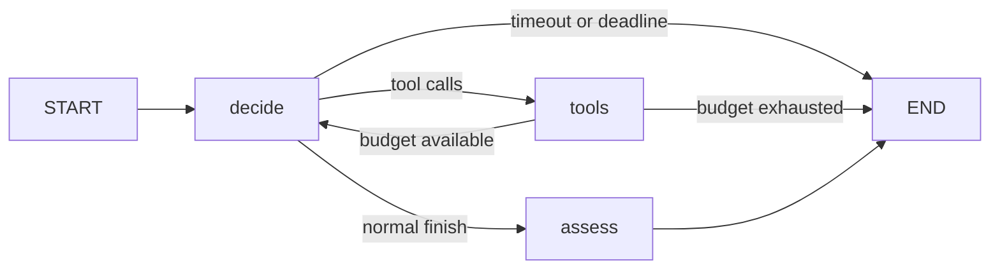

# DebateBot

The web UI uses a focused, centered dark layout with **Chat**, **Evidence Lab**
and **Quick critique** tabs. Frontend code is separated into local CSS and
scripts under `web/static`; no CDN or frontend build step is required.
See [DESIGN.md](DESIGN.md) for the reference and design decisions, and
[AI_LEARNING_GUIDE.md](AI_LEARNING_GUIDE.md) for the implementation walkthrough.

**Run the server; do not double-click `web/static/index.html`.** From the project
folder run `./start.ps1` (or the uvicorn command below), then open
[http://127.0.0.1:8000/](http://127.0.0.1:8000/). The file:// page cannot load
root-relative assets or API routes and now shows explicit startup instructions.
Keep the server terminal running. The local PostgreSQL cluster must also be running.

An AI that disagrees with you — three different ways. Built to pressure-test
arguments before you ship them in a PR, an essay, or a behavioral-interview
answer.

Unlike sycophantic LLMs that agree with whatever you say, DebateBot picks
the strongest counter-argument, asks the question that exposes the hidden
assumption, or builds the steel-manned opposite case — and then surgically
identifies the single weakest claim in your argument.

---

## What's actually interesting under the hood

Most Gen AI side projects are a chat UI over an API. The interesting parts
here are the production-engineering patterns:

- **LLM-as-judge** scorer that grades arguments on 4 axes (logic, evidence,
  opposition handling, clarity) with calibrated 1-10 ratings. Verified
  calibration: same claim defended weakly scores 2/10, defended rigorously
  scores 7/10 — a 5-point spread.
- **Structured output** via a 3-layer defense (prompt schema + Groq JSON
  mode + Pydantic validation + retry-on-failure). No string-mashing
  hopes-and-prayers parsing.
- **Find-the-hole** surgical analyzer that picks the single most
  load-bearing weakness in your argument, quotes it verbatim, and
  constructs the precise attack. Forced grounding via "verbatim quote
  required" in the prompt — no generic "consider adding more evidence"
  feedback.
- **Eval harness** with 10 hand-designed test cases across 10 fallacy
  categories. The interesting story is documented below.

## The eval story (the part I'm proudest of)

The ten cases below were used to tune the prompt and are development results,
not a held-out estimate of accuracy on unseen arguments.

I built a benchmark of 10 arguments, each with a known intended weakness
(false dichotomy, appeal to authority, slippery slope, strawman, etc.).
An LLM-as-judge eval runner compares find_hole's output against the
intended weakness and marks each case HIT / PARTIAL / MISS.

| Iteration | HIT | PARTIAL | MISS | Note |
|---|---|---|---|---|
| Baseline | 7 | 2 | 1 | Content-level bias — caught evidence gaps, missed structural fallacies |
| Fix #1 (broad categories) | 7 | 2 | 1 | **Same headline number, composition shifted**: cherry-picking improved, vague_terms regressed |
| Fix #2 (per-fallacy quote rules) | **10** | 0 | 0 | Clean win |

The middle row is the lesson. Without the eval harness, the
composition-shifted side-effect of Fix #1 would have been invisible.
Vibes can't tell you that. Measurement can.

See [`LEARNINGS.md`](LEARNINGS.md) Day 6 for the full diagnosis and the
exact prompt changes.

## Architecture

```
                       ┌───────────────────┐
                       │  web/static/...   │ vanilla JS + Tailwind via CDN
                       │  index.html       │ (no build step)
                       └────────┬──────────┘
                                │ fetch()
                       ┌────────▼──────────┐
                       │  web/api.py       │ FastAPI (transport only,
                       │  + in-mem sessions│  zero business logic)
                       └────────┬──────────┘
                                │
        ┌───────────────┬───────┼───────┬───────────────────┐
        ▼               ▼               ▼                   ▼
   ┌──────────┐  ┌───────────┐  ┌──────────┐         ┌──────────────┐
   │personas. │  │ debate.py │  │ scorer.  │         │ find_hole.py │
   │py        │  │           │  │ py       │         │              │
   │3 system  │  │ multi-    │  │ 4-axis   │         │ surgical     │
   │prompts   │  │ turn      │  │ LLM-as-  │         │ weakness     │
   │as config │  │ state     │  │ judge    │         │ analyzer     │
   └─────┬────┘  └─────┬─────┘  └─────┬────┘         └──────┬───────┘
         │             │              │                     │
         └─────────────┴──────────────┴─────────────────────┘
                                │
                       ┌────────▼──────────┐
                       │   Groq API        │  Llama 3.3 70B
                       │   (free tier)     │
                       └───────────────────┘

Separately: benchmark.py + eval_findhole.py — measurement infrastructure.
```

## Quick start

Requires Python 3.10+. Get a free Groq API key at
[console.groq.com](https://console.groq.com).

```bash
git clone https://github.com/zsklav/debatebot.git
cd debatebot
python3 -m venv .venv
.venv/bin/pip install -r requirements.txt
cp .env.example .env       # then put your key in .env: GROQ_API_KEY=gsk_...
```

### Run the CLI

```bash
.venv/bin/python chat.py
```

Pick a persona, make a claim, defend it across a few turns. Type `/score`
to get a 4-axis grade or `/findhole` to surface the surgical attack.

### Run the web app

```bash
.venv/bin/uvicorn web.api:app --reload
```

Open http://127.0.0.1:8000 in your browser.

### Run the eval harness

Model selection is centralized in `model_config.py`. Optional `.env` settings:
`DEBATEBOT_MODEL` sets the shared fallback; `DEBATEBOT_DEBATE_MODEL`,
`DEBATEBOT_FINDHOLE_MODEL`, `DEBATEBOT_SCORER_MODEL`, and `DEBATEBOT_JUDGE_MODEL`
override individual roles. Explicit Python `model=` arguments take priority.
Unset settings retain the original model; blank settings raise an error.
Restart the app after editing `.env`. Existing debate sessions keep the model
selected at their creation. These settings choose models on Groq, not providers;
use IDs available to your account and supporting the required response format.
The standalone `hello_groq.py` tutorial keeps its original hardcoded example.

The evaluation runner prints analyzer and judge model IDs for comparison. Both
still default to the same model; a separate judge call alone does not provide
independent ground truth. Importing the evaluator does not create a client or
require credentials; running a live evaluation does.

```bash
.venv/bin/python eval_findhole.py
```

Takes ~30 seconds. Output: per-case verdicts + category breakdown +
diagnostic detail on any miss/partial.

## File map

### Continuous integration

`.github/workflows/ci.yml` runs on pushes, pull requests, and manual dispatch.
It defines Python 3.12/3.13 jobs on Linux with an ephemeral PostgreSQL 17 service,
plus a Node 22 frontend job. Python jobs install the declared dependency sets,
check compatibility, and run the full offline suite with SQL integration enabled.
Frontend checks cover syntax and Node DOM-contract tests.

No API secrets are configured in CI. Generation and search are mocked, embedding
model downloads are disabled, and the opt-in cached-model smoke is skipped. The
database password in the workflow belongs only to its temporary test service.
Checkout credentials are not persisted, repository permissions are read-only,
jobs have time limits, and new runs cancel superseded runs on the same ref.

The workflow YAML and equivalent local checks were verified; **GitHub-hosted runs
have not yet been executed** because these local changes have not been pushed.
Do not add a passing-CI badge until a hosted run actually passes. Package installation
and the Linux/Python matrix still need that first hosted verification.

Docker's build context now excludes `.data` and local environment variants, keeping
development database files/passwords, models, and local reports out of image builds.
The example environment template remains available. A Docker build has not been
verified, and the Dockerfile still needs deployment dependency/storage review.

### Public web research (prototype)

Select **Web research (public sources)** in Evidence Lab. The API accepts
`POST /api/research` with `{"claim":"A specific measurable claim","source":"web"}`.
Local mode remains the default and still uses the two-study Qdrant corpus. Web
mode does not require a local Qdrant index: it uses public search results and
reads selected HTTPS pages before citation-validated assessment.

Provider configuration in ignored `.env`:

```dotenv
DEBATEBOT_WEB_PROVIDER=auto
TAVILY_API_KEY=your_key_here
```

`auto` uses Tavily when a nonblank key is configured; otherwise it uses the optional
DDGS/Bing best-effort prototype (`pip install -r requirements-web.txt`). Explicit
`tavily` requires a key; explicit `ddgs` selects the key-free backend. Restart the
server after editing settings. Provider queries and fetched source content leave
the application; do not enter confidential material in web mode. Tavily usage may
consume provider credits. No key is embedded in the frontend or returned in traces.

**Live verification limit:** one DDGS search returned research sources, but later
searches failed. A real public-page fetch from python.org succeeded; one academic
site failed TLS. Tavily's request adapter is mock-tested, not live-tested: no
Tavily key is configured yet. End-to-end live web-agent quality is unverified.
Do not describe this as a reliable arbitrary-topic research service yet.

The agent can reformulate queries, inspect previews, and read returned IDs. Only
fetched excerpts become final evidence. Source cards retain source URLs, fetched
timestamps, content hashes, and normalized-text spans. Page excerpt selection is
a simple lexical baseline, not a semantic web reranker. Search ranking is not truth
or confidence. A vague judgment such as 'CEO is not smart' still requires definitions
and relevant evidence; web access does not make it a checkable factual claim.

Reads support public HTTPS port 443 only. DNS answers must all be globally routable;
connections pin a validated IP while preserving certificate verification/SNI.
Redirects are revalidated. Local/private/link-local targets, embedded credentials,
compressed responses, PDFs, non-text responses, oversized bodies, and unknown IDs
are rejected. No user cookies/auth headers are forwarded to source sites. Text
extraction removes script/style/navigation elements but cannot remove all prompt
injection from source prose; the agent's tool allowlist/budgets remain necessary.

Each search returns at most two candidates; existing agent search/tool/deadline
budgets apply. Page reads have a ten-second cooperative deadline, four-hop limit,
one-MB response cap, and excerpts up to 180 words/5500 characters. DNS/local work
is not forcibly cancellable. Some valid sites will fail or refuse access; the app
does not bypass login, paywalls, CAPTCHAs, or TLS validation. Search/read failures
without inspected evidence return a partial `tool_error` run, not an absence-of-
evidence verdict. Provider rate/latency and real output quality still need evaluation.

References: [DDGS](https://github.com/deedy5/ddgs),
[Tavily Search](https://docs.tavily.com/documentation/api-reference/endpoint/search).

### Accounts and record ownership

Authentication is now required by default. Start the API locally, open the page,
and create your own username/password account. Passwords must be 12–128 characters;
usernames contain 3–40 letters, digits, underscores or hyphens. No external identity
provider or email verification is involved. Never reuse the sample test passwords.

Apply the additive ownership migration before starting:

```powershell
.\.venv\Scripts\python.exe storage.py migrate
.\.venv\Scripts\python.exe -m uvicorn web.api:app --host 127.0.0.1 --port 8000
```

Endpoints: `/api/auth/register`, `/api/auth/login`, `/api/auth/logout` (JSON POST),
and `/api/auth/me` (GET). Passwords use unique salts with PBKDF2-HMAC-SHA256 at
600,000 iterations. Login issues a random, seven-day, HttpOnly, SameSite=Strict
cookie; only its SHA-256 digest is stored server-side. Login rotates the current
browser token; logout revokes it. Raw tokens/passwords are not saved in browser
localStorage. API errors do not echo invalid credential fields.

All debate/session/run access is scoped to the authenticated owner, including
updates, scoring, analysis, and reopen. Other users' IDs return 404. Unauthenticated
requests cannot invoke LLM endpoints. Public health/persona endpoints expose no
private records. API responses use no-store cache headers. Account switches clear
displayed results and ignore responses from the prior account's in-flight work.

Migration 002 adds accounts/auth sessions and nullable owner columns. **Existing
ownerless records remain preserved but are not accessible through authenticated
routes.** They are never automatically assigned to the next person who registers.
There is no account-claim UI; explicit administrative migration would be needed
to attach legacy records to an intended owner.

Writes check Origin (when present), reject cross-site Fetch Metadata, and require
JSON. Cookie SameSite protections also apply. For HTTPS deployment configure the
exact `DEBATEBOT_PUBLIC_ORIGIN`; cookies then default to Secure. Never set
DEBATEBOT_COOKIE_SECURE=0 on a public HTTPS deployment. Proxy/origin configuration
needs deployment-specific testing; there is no permissive CORS setup.

Authentication attempts are bounded to ten per source IP per minute per process.
This is a small local safeguard, not distributed abuse protection. Public signup
still needs a quota/invitation strategy and per-user inference limits before public
deployment. Password resets, MFA, account deletion, verified identities, and a
distributed limiter are not implemented. This has tests, not a security audit.

Set `DEBATEBOT_AUTH_REQUIRED=0` only for an explicit trusted local demo/test. It uses
one shared `local-demo` owner and must not be publicly deployed. Memory storage
also supports accounts, but they disappear on restart. PostgreSQL stores them
durably. CLI and live_smoke are local tools and do not use browser login.

Security reference: [OWASP password storage guidance](https://cheatsheetseries.owasp.org/cheatsheets/Password_Storage_Cheat_Sheet.html).

### Persistent sessions and saved runs

Application storage uses PostgreSQL when `DATABASE_URL` is configured. Without it,
the app explicitly uses volatile memory mode; `/api/health` reports which mode is
active. A configured database failure returns 503 instead of falling back to memory.
Install the optional driver and migrate before starting the API:

```powershell
.\.venv\Scripts\python.exe -m pip install -r requirements-storage.txt
.\.venv\Scripts\python.exe storage.py migrate
```

For this Windows development checkout, PostgreSQL 17 binaries were already installed.
An isolated password-protected cluster has been initialized at `.data/postgres-dev`,
bound to `127.0.0.1:55432`. Its generated local credentials and DATABASE_URL are stored
only in ignored `.data`/`.env` files. Existing database services were not modified.
The database remains running for local use; it is not installed as an autostart service.

```powershell
.\.venv\Scripts\python.exe dev_postgres.py start
.\.venv\Scripts\python.exe storage.py migrate
# When finished with local development:
.\.venv\Scripts\python.exe dev_postgres.py stop
```

The helper requires installed PostgreSQL binaries and Psycopg; pass `--bin` if
the installation path differs. It creates only its dedicated cluster/database and
does not replace an existing DATABASE_URL. On other platforms, configure your own
PostgreSQL service and DATABASE_URL. Do not copy the local password into tracked
files. Migration 001 is additive and repeatable; it is not an automatic upgrade
or destructive reset tool.

Session snapshots retain model selection, original system prompt, conversation
messages, token count, and revision. Each successful turn updates only the revision
it loaded. A competing update returns 409 rather than overwriting an intervening
turn; generation may already have used quota before a conflict is detected.
Failed generation never commits a half-turn. Model requests run outside DB
transactions, so connections/row locks are not held during inference.

Evidence and research results (including partial research) are saved with a
`run_id`. `GET /api/runs/{run_id}` reopens a result without generation. The Evidence
Lab displays run IDs and includes an open-saved-result control; the browser stores
only the last run ID locally. The last debate ID is also remembered so a reload
can restore its messages. Memory mode supports the same API but loses records on
restart. CLI/live_smoke runs do not yet save into PostgreSQL.

Run/session endpoints now enforce account ownership by default. This remains a
local prototype pending deployment hardening and inference quotas. There is no
run-list UI, retention/deletion
policy, connection pool, database backup workflow, or durable LangGraph checkpointer.
Saved final/partial outputs are not resumable graph checkpoints. Qdrant still
stores vectors separately and remains single-process local mode.

Persistence verification uses real PostgreSQL with mocked model calls. Tests use
unique record IDs and remove only their own rows. Opt in against a development DB:

```powershell
$env:RUN_POSTGRES_TESTS = '1'
.\.venv\Scripts\python.exe -m unittest discover -s tests -p test_storage.py -v
Remove-Item Env:RUN_POSTGRES_TESTS
```

`DEBATEBOT_TEST_DATABASE_URL` can select a dedicated test database; otherwise tests
read the local ignored .env. Fourteen storage checks passed, including a new API
instance reopening a debate and partial research result. That simulates an app
restart, not a machine/database crash. Browser reopen logic has a Node DOM-contract
test; the new reopen controls have not yet been manually browser-tested.

Reference: [Psycopg connection/transaction behavior](https://www.psycopg.org/psycopg3/docs/api/connections.html).

### Live smoke check

The first three live checks completed and were manually reviewed. See
[live smoke review](eval_results/live_smoke_review.md) for results, fixes, and
limitations. The default is now `openai/gpt-oss-20b` through Groq because the old
Llama model was unavailable to this account. This is not an accuracy benchmark.

Set `GROQ_API_KEY` in your ignored local `.env`, then run:

```powershell
.\.venv\Scripts\python.exe live_smoke.py
```

This consumes Groq API quota: two fixed evidence assessments and one bounded
LangGraph research run. It uses cached embeddings and the existing local index.
The report is saved under `.data/live_smoke.json`, with models, per-case latency,
results, tool events, and sanitized exception types. Authentication/rate-limit
failures stop remaining cases. No secrets or raw provider error messages are
included. This checks execution, not correctness: manually review whether the
retention claim is properly scoped and the blood-pressure claim abstains. A
received response or completed graph run is not automatically a passing answer.

### Evidence Lab UI

The existing FastAPI-served page now includes an Evidence Lab. Choose fixed
weakness/evidence analysis or agent research, enter up to 4000 characters, and
submit. Results show reasoning separately from evidence, citation/source cards,
retrieved passages, and completed research tool events. Partial research runs
have a distinct state and do not display a fabricated verdict. Activity appears
after the request finishes; SSE streaming is not implemented.

Inputs are preserved on errors, duplicate submissions are blocked while busy,
and missing-index/provider failures have readable retry guidance. Source/model
strings are rendered with textContent; external links accept only credential-free
HTTP(S). Existing inline error rendering was also changed to use text nodes.
This is the original vanilla-JavaScript UI; Next.js migration is still planned.

After setting your local key and indexing sources, start the real app:

```powershell
.\.venv\Scripts\python.exe -m uvicorn web.api:app --host 127.0.0.1 --port 8000
```

Open http://127.0.0.1:8000/ and use one API worker with local Qdrant. Submitting
real analyses consumes Groq quota. To inspect UI behavior without generation:

```powershell
.\.venv\Scripts\python.exe tests\ui_preview.py
```

Open http://127.0.0.1:8765/static/index.html. This is a **fixture-only test server**,
not a deployment or live AI demo. Evidence results explicitly identify fixture
sources; research returns a partial run. Enter `setup-error` to simulate HTTP 503.
Stop the server with Ctrl+C. Do not use the fixture server for normal debates.

Frontend tests use Node's built-in runner with no npm dependencies:

```powershell
node --test tests\test_ui.cjs
```

Seven frontend tests pass. The latest Python suite ran 105 checks successfully with PostgreSQL integration enabled and
one opt-in cached-model smoke skipped (that smoke passed previously). Browser checks on the fixture server
covered citation rendering, partial research, setup-error recovery, and inert HTML
in output at the available narrow viewport. Desktop breakpoint coverage, full
accessibility review, and live-model UI validation remain pending.

### Bounded research agent

`POST /api/research` accepts `{"claim":"Does hybrid work reduce quitting?"}`.
Use the same retrieval installation/index setup and Groq key as evidence analysis.
Optionally select a tool-capable Groq model via `DEBATEBOT_RESEARCH_MODEL`.

Unlike fixed retrieval, the model chooses native function calls: `search_evidence`
returns up to two passage previews, and `read_passage` opens an ID already returned
by search. It can reformulate a query after inspecting results. Final assessment
uses only explicitly opened passages and the existing citation validator. No web,
shell, filesystem, or write tool is available to the model.

Defaults enforced by code: four planner steps, six executed tool calls, three
searches, five distinct inspected passages, and a 45-second cooperative deadline.
Planner replies have a 1500-token output cap; final assessment has a 2400-token
cap and no validation retry. Provider requests use the remaining timeout and no
SDK retries. Synchronous local work is checked before/after operations, not forcibly
interrupted, so this is not a hard wall-clock cancellation guarantee.

The result contains `status`, `termination_reason`, tool events, read passages,
and an optional `assessment`. Step/tool/deadline exhaustion or provider timeout
returns a partial run without a factual verdict. Other provider/invalid-output
errors return API 502. A normal finish without any read evidence returns
insufficient evidence, without generating an assessment. Events record tool
inputs/results, not private model reasoning. They may contain source text;
there is no durable run storage or redaction pipeline yet.

The implementation now uses **LangGraph StateGraph** with separate `decide`,
`tools`, and `assess` nodes. Conditional edges loop through tools or terminate
on budgets; assessment runs only on normal completion. State includes messages,
discovered/read passages, counters, deadline, events, and assessment. The API
response includes `orchestrator: "langgraph"` and the executed `node_history`.
There is no checkpointer, durable resume, or hosted LangGraph service configured.
It uses Groq's
[documented local tool-calling protocol](https://console.groq.com/docs/tool-use/local-tool-calling).
The Evidence Lab research mode uses this endpoint. All agent tests script model tool
responses: they verify orchestration and budgets, not live model decision quality,
prompt-injection resistance, or improvement over the retrieval baseline.

LangGraph is pinned in requirements.txt. Reinstall it when updating this checkout:

```powershell
.\.venv\Scripts\python.exe -m pip install -r requirements.txt
$env:RUN_LOCAL_EMBEDDING_SMOKE = '1'
.\.venv\Scripts\python.exe -m unittest discover -s tests -p test_langgraph.py -v
Remove-Item Env:RUN_LOCAL_EMBEDDING_SMOKE
```

The opt-in smoke uses cached real BGE embeddings, local Qdrant, and actual graph
execution with a **scripted generation client**. It validates wiring and citation
provenance, not live intelligence. Normal tests skip that one smoke unless opted in.
A local .env is now configured and ignored by Git. On a fresh checkout, create it
from .env.example and set your own Groq key. Never commit credentials.



Implementation reference:
[LangGraph control flow](https://docs.langchain.com/oss/python/langgraph/graph-api-control-flow).

### Assess a claim against local evidence (Phase 2)

The API also exposes `POST /api/findhole/evidence` with a JSON body:

```json
{"argument":"Hybrid work always improves productivity.","limit":3}
```

It returns `weakness` (the original argument diagnosis) and `evidence` (assessment
of the exact selected quote). This checks one quote, not every factual claim in
the argument. The evidence verdict does not overwrite the rhetorical diagnosis.
Existing `/api/findhole` and session routes keep their original behavior. The
Evidence Lab fixed-analysis mode is wired to this endpoint.

Install retrieval dependencies and run `retrieval.py index` before using the new
endpoint. It loads only cached embedding files, lazily on first use; there are no
automatic model downloads during API startup. `DEBATEBOT_EVIDENCE_STORAGE` and
`DEBATEBOT_EMBEDDING_CACHE` can override the repository-local defaults. The API
serializes local index use in one process and closes Qdrant clients after requests.
Use a **single API worker** with local Qdrant; do not run indexing concurrently.
Server-mode Qdrant is required before multi-worker deployment. Requests currently
hold the local lock during generation; this is a demo throughput limitation.

Empty/oversized inputs are rejected. Missing index/dependencies return 503;
provider errors or exhausted output validation return 502. Error responses do
not include raw provider messages or private paths. Generation in the combined
flow remains mock-tested only. The real cached embedding/index resource factory
was also checked separately, without a live generative call.

After installing retrieval dependencies and indexing sources, set `GROQ_API_KEY`
in your local `.env`, then run:

```powershell
.\.venv\Scripts\python.exe evidence.py "A two-day hybrid schedule reduced quitting in the studied Chinese technology workforce."
```

Unlike retrieval-only commands, this makes a live Groq generation request and
uses API quota. Embeddings use cached files only. Optional settings include
`DEBATEBOT_EVIDENCE_MODEL`, `--storage`, `--cache`, and `--limit` (1-5).

The report returns the claim, verdict, explanation, suggested revision, validated
citations, and retrieved passages. Verdicts are supported, contradicted, mixed,
insufficient_evidence, or not_checkable (for non-empirical claims). These labels
apply only to the available evidence. No returned passages means deterministic
insufficient evidence without a generation call. Irrelevant returned passages
require the model to abstain; that behavior is not guaranteed by retrieval.

Code checks that citation IDs were retrieved and quoted text exists exactly in
the corresponding passage. If a model flattens source line breaks, code may restore whitespace
only, then revalidate the exact source substring; repairs are returned explicitly
in `citation_repairs`. Words, punctuation, and numbers are not fuzzily repaired.
Supported/contradicted verdicts require matching
relations; mixed requires both. Source URLs and provenance come from retrieval,
not generated output. These checks do **not** establish semantic entailment or
validate every sentence in explanations/revisions. Invalid model output retries
once by default, then raises an error rather than becoming a fake evidence verdict.

Source instructions are placed in a lower-priority data message, with no tools
available to the assessor. This limits capabilities but does not prove immunity
to answer contamination. Tests exercise malicious-text message placement and
fabricated-citation rejection, not live attack success rates. All evidence
generation tests use mocks; live assessment quality has not been evaluated yet.
The standalone claim CLI remains available alongside the combined API endpoint.
Pure retrieval and prompt-only analysis remain available.

### Local semantic retrieval (Phase 1)

Install the optional, pinned retrieval dependencies. The first index run downloads
the small English embedding model (about 67 MB of weights plus tokenizer files):

```powershell
.\.venv\Scripts\python.exe -m pip install -r requirements-retrieval.txt
.\.venv\Scripts\python.exe retrieval.py index
.\.venv\Scripts\python.exe retrieval.py search --offline --query "Does hybrid work reduce employee resignations?" --limit 3
.\.venv\Scripts\python.exe retrieval.py evaluate --offline --limit 1 --output eval_results\retrieval_development_k1.json
```

The first command needs network access; after the model is cached, `--offline`
prevents model downloads. Indexing and searching run on CPU without a Groq key.
The CLI uses FastEmbed's BAAI/bge-small-en-v1.5 (384 dimensions) and Qdrant's
embedded local mode. `.data/models` and `.data/qdrant` are ignored by Git.
Use `--storage` and `--cache` for alternate paths. Run one process per local store;
this is a development prototype, not a multi-worker production database.

Only sources in [corpus/manifest.json](corpus/manifest.json) are indexed. The
[corpus notes](corpus/README.md) identify authors, links, reuse licenses, and
changes. This initial corpus contains **two editorial summaries of real studies**,
not verbatim paper excerpts or a complete research library. Lines and character
spans refer to the local summary. Every search result returns this distinction
along with its source URL, title, dates, license, chunk ID, revision, and score.

Retrieval uses 80-word windows and 16-word overlap by default. Unlike the generic
ingestion command, the embedding adapter also rejects token-overflowing inputs
instead of silently truncating them. A model-artifact hash and library version
separate incompatible vector spaces. Changing chunking settings requires
reindexing and passing the same settings to evaluation.

Reindexing upserts stable IDs, then removes obsolete chunks **for the indexed
source**. Embedding errors occur before writes. Cleanup is not transactional:
a crash between upsert and deletion can leave mixed revisions until rerun.
Removing a source from the manifest does not delete it from an existing store;
use a fresh `--storage` directory when testing a reduced corpus. PostgreSQL
application metadata storage and API integration are still planned.

Saved real-model development runs are in [eval_results](eval_results/README.md).
On six answerable queries, top-1 evidence hit rate was 4/6; top-3 was 6/6.
Top-1 mean chunk recall was 0.5833 and top-3 was 1.0. Recall counts overlapping
chunks containing an annotated passage; hit rate requires at least one. These
numbers come from **only four chunks**, so top-3 is an easy smoke check, not a
held-out accuracy claim. Both no-evidence queries also returned nearest passages.
Cosine similarity is neither truth nor confidence; no answer generation or
automatic evidence verdict is connected yet.

References used for implementation:
[Qdrant local-mode client](https://github.com/qdrant/qdrant-client#local-mode),
[Qdrant queries](https://qdrant.tech/documentation/quickstart/#run-a-query),
[FastEmbed](https://github.com/qdrant/fastembed), and
[BGE model documentation](https://huggingface.co/BAAI/bge-small-en-v1.5).

The full test suite uses real in-memory/local Qdrant with deterministic test
vectors, not downloaded model inference. Qdrant tests are skipped if its optional
dependency is missing. Real-model runs above were executed separately. The pinned
FastEmbed adapter uses backend tokenizer/model-directory attributes for overflow
checks and artifact hashing; verify these when upgrading FastEmbed.

### Inspect document chunks (Phase 1)

The local ingestion command reads UTF-8 `.txt` and `.md` files and prints JSON.
It does not embed, index, or retrieve documents yet. Try the fictional fixture:

```powershell
.\.venv\Scripts\python.exe ingestion.py examples\chunking_demo.md --source-id demo-fictional --chunk-words 40 --overlap-words 8
```

Each chunk has an exact text span, line numbers, document ID, revision hash, and
chunk ID. Use a unique, persistent `--source-id` for each source, even if its file
moves. Optional `--title`, `--source-url`, and `--source-date` preserve provenance
metadata; they are supplied by the caller and are not independently verified.
Offsets count decoded characters, not bytes. Defaults are 160 words with 32 words
of overlap; words here are whitespace-separated spans, not model tokens.

Repeating ingestion gives the same IDs. Changing content or chunk settings gives
new chunk IDs. This enables future upserts but does not itself persist records,
deduplicate a database, or delete stale revisions. The demo is fictional and is
not a research source.

### Offline regression tests

These checks cover conversation state after failures, empty replies, exact-quote
validation, bounded retries, model configuration, and API/CLI integration flows.
They use mocked model responses and need no API
key. After installing requirements, run on Windows:

```powershell
.\.venv\Scripts\python.exe -m unittest discover -s tests -v
```

API tests use an in-process HTTP client; on Windows the async runtime still needs
local socket access. Run outside a sandbox that blocks those sockets. A simulated
provider failure currently returns HTTP 500 while preserving the session for retry.

The live LLM evaluation harness measures a different concern: argument-analysis
quality. See [ROADMAP.md](ROADMAP.md) for v2 plans and
[AI_LEARNING_GUIDE.md](AI_LEARNING_GUIDE.md) for the learning track.

| File | Purpose |
|---|---|
| `hello_groq.py` | Minimal one-shot LLM call — the foundation example. |
| `personas.py` | The three personas as a configuration dict. |
| `debate.py` | `Debate` class encapsulating per-session conversation state. |
| `scorer.py` | LLM-as-judge argument scorer. |
| `find_hole.py` | Surgical weakness analyzer (the differentiator). |
| `benchmark.py` | 10-case eval benchmark with intended-weakness annotations. |
| `eval_findhole.py` | Eval runner with LLM-as-judge grading. |
| `chat.py` | Interactive CLI (single-persona, multi-persona compare, standalone find-the-hole). |
| `web/api.py` | FastAPI HTTP layer. |
| `web/static/index.html` | Single-page chat UI. |
| `Dockerfile` + `fly.toml` | Deploy artifacts for Fly.io. |
| `LEARNINGS.md` | Concept-by-concept walkthrough with interview talking points. |

## Tech stack

- **Python** (tested locally on 3.13), **FastAPI**, **Pydantic v2**
- **GPT-OSS 20B via Groq**, configurable per role
- **LangGraph**, **FastEmbed/BGE**, **Qdrant** for bounded agentic retrieval
- **PostgreSQL + Psycopg** for persistent sessions and analysis results
- Vanilla JS + Tailwind via CDN on the frontend (no build step)
- Docker + Fly.io deployment files; public deployment is not yet verified

## What's deliberately out of scope (v1)

- **Auth / users (implemented in v2)**. Local accounts, revocable cookies and
  ownership checks are implemented; production quotas and account recovery remain.
- **Persistent sessions (implemented in v2)**. PostgreSQL now stores session
  snapshots and analysis runs when configured. Memory mode remains a volatile demo.
- **CI**. Offline regression tests now cover selected application failure paths;
  automated CI and broader integration checks remain planned.

These were chosen deliberately so the project stays small enough to
explain line-by-line in an interview.

## Reading guide

If you have 5 minutes: scan this README and skim [`LEARNINGS.md`](LEARNINGS.md).

If you have 30 minutes: read `find_hole.py` + `scorer.py` (the heart of
the project) and the Day 4-6 sections of `LEARNINGS.md`.

If you have an hour: run `eval_findhole.py`, then read `benchmark.py` and
Day 6 of `LEARNINGS.md` to see the measure-diagnose-fix-remeasure loop in
action.

## Token and request budgets

Chat sends at most four recent complete exchanges (12,000 history characters),
plus bounded excerpts of the opening exchange and the latest message (up to
4,000 characters). Full transcripts remain saved for display and on-demand
whole-debate analysis. This is a character budget, not an exact token limit;
older details can be missed, so users may need to restate them. History selection
is local and makes no summarization API calls.

Replies are prompted to stay under 120 words and have a 768-completion-token
ceiling, including model reasoning where applicable. Actual replies can be
shorter, hit the limit, or fail validation; this is not a guaranteed word count.
The API client disables hidden transport retries. Structured JSON analyses
retain one repair retry, and agent research retains its separate step budget.

Successful scores and find-the-hole results are reused for 10 minutes by exact
input, model and account. Concurrent identical requests share generation. The
cache is bounded to 128 results per process; restart, expiry, another worker,
input changes or a model change can cause a fresh request. Failures are never
cached. Web research is not cached because sources may change.

## Local relevance screening

API evidence routes and the evidence CLI now screen semantic candidates with
`relevance.py`. The heuristic normalizes common outcome synonyms, ignores generic
work-arrangement words and requires at least half the claim's remaining unique
terms in a passage/title. Cosine similarity alone never bypasses this screen.
It is conservative keyword overlap, not a learned relevance classifier or proof
of entailment; unfamiliar paraphrases may be rejected and lexical matches can
still be irrelevant. The evidence assessor remains responsible for judging
support and source scope on accepted passages.

Local agent research first makes one local embedding/search preflight. If no
candidate passes, it reports insufficient evidence without starting LangGraph
or making an LLM call. The report identifies this as a preflight, not agent tool
activity. Covered claims continue through the graph; two empty agent searches
with no discovered/inspected evidence terminate early. Preflight metadata is
reported separately for runs that continue. Web mode stays explicitly selected
and uses its existing provider/read budgets; it is never activated automatically.
