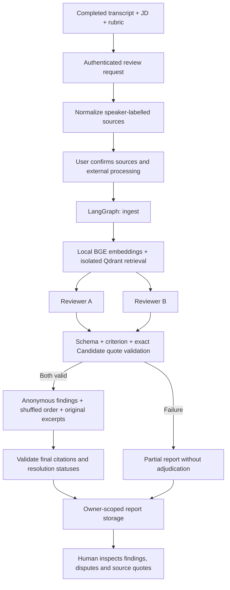

# Architecture

The repository contains one FastAPI application with three feature areas:
persona debates, evidence research and post-interview review. The frontend is
served locally by the API. Claim CI and evaluation commands are development
tools, not application startup tasks.

## Application composition

`app/main.py` creates the ASGI application through
`app/api/application.py:create_app`. Importing the factory alone does not create
an application, read `.env`, construct a model client or connect to PostgreSQL.
The factory accepts a repository and model client for tests; each application
gets its own authentication state and analysis/review caches. Only clients
created by the factory are closed by its lifespan handler.

The factory loads the repository-root `.env` for normal startup, selects the
configured repository, registers security/error handling, and mounts:

| Component | Responsibility |
| --- | --- |
| `app/auth.py` | Accounts, password hashing, session cookies and origin checks |
| `app/api/debates.py` | Debate and critique HTTP contracts |
| `app/api/evidence.py` | Evidence/research HTTP contracts and saved-run reads |
| `app/review/routes.py` | Source preview, review requests and owner-scoped report reads |
| `frontend/` | HTML/CSS/JS served at `/static`; workspaces at `/` and `/review` |

HTTP routers map requests to feature functions. Model prompts, retrieval and
review orchestration belong in their feature modules. Application storage and
authentication are shared; feature logic does not import the ASGI entry point.

## Review flow

`app/review/models.py` owns input/output contracts and deterministic validation.
`evidence.py` preserves speaker labels, source IDs and line ranges. It indexes
only Candidate answers in a new in-memory Qdrant collection for each run;
questions and optional resume context are attached separately. Vectors are
closed after retrieval and never mixed across reviews.

`council.py` owns the LangGraph workflow. Two reviewers see the same frozen
retrieved excerpt subset and rubric, without seeing each other's initial
findings. The adjudicator sees anonymous reviewer IDs, original selected sources
and shuffled reviewer order. Provider labels remain in the audit record. Invalid
reviewer output skips adjudication; invalid final output remains partial. An
unassessed skill does not establish lack of ability.

`providers.py` supplies the common LangChain Runnable interface for explicit
Groq/OpenRouter routes. It bounds requests/timeouts, records usage and validates
transport completion. It makes no automatic retry or provider fallback. A new
live review makes at most two reviewer requests and one adjudicator request.
`demo.py` uses the same workflow with explicitly scripted outputs and zero model
requests. It is not a model benchmark.

## Other feature boundaries

- `app/debate/`: persona configuration, bounded conversation context, argument
  scoring and single-weakness critique. The API supplies the model client.
- `app/evidence/`: deterministic ingestion, local Qdrant index, relevance
  screening, cited assessment, bounded LangGraph research and optional web
  retrieval. The curated study corpus is separate from interview evidence.
- `app/core/`: shared model selection, successful-result reuse and absolute
  repository resource locations. It does not depend on feature routers.
- `app/storage.py`: memory/PostgreSQL records, ownership filters and optimistic
  session updates. It serializes/restores the existing Debate domain snapshots;
  review reports are stored as private run records.
- `tools/`: module-based entry points for CLI/evaluation, development PostgreSQL
  and Claim CI. Application modules do not import these tools.

## Persistence and resource paths

`app/core/paths.py` resolves the frontend, migrations and repository root from
the package location. Moving Python modules or changing the working directory
does not relocate `.env`, the embedding cache, the development database or SQL
migrations. Existing `.data/`, corpus files, account data and migrations retain
their locations. CLI commands should still be launched from the repository root
when supplying relative file arguments.

| Data | Storage and lifetime |
| --- | --- |
| Accounts, sessions, debates and saved reports | PostgreSQL with `DATABASE_URL`; otherwise explicitly volatile memory |
| Standard Evidence Lab corpus vectors | `.data/qdrant`, with single-process serialized access |
| Interview source vectors | Per-run in-memory Qdrant; closed after retrieval |
| Embedding weights | `.data/models`; setup downloads explicitly, API uses cached files |
| Successful analysis/review reuse | Bounded per-application memory, ten-minute TTL, owner/configuration/input-specific keys |
| Claim observations | Ignored `claimci-observations/`, separate from application data |

Reports contain source text. Source vectors being ephemeral does not make saved
reports ephemeral. Report deletion/retention controls and finding-level human
corrections are not implemented yet. Real interview material requires appropriate
authorization; no automatic PII redaction is supplied.

## Dependency installation and operation

The root `requirements.txt` includes the dependency groups under `requirements/`.
It is the complete installation used by Docker and application CI. The read-only
Claim CI job installs its smaller checker dependency separately.

Use `python -m uvicorn app.main:app` for the API, `python -m app.storage migrate`
for SQL migrations, and `python -m tools.<command>` for development tools.
Source preview and the scripted sample do not require a generation key. Debate
generation without a key returns a setup error; live council configuration is
checked independently. Persistent database setup failures never silently fall
back to memory.

## Verification and remaining limits

Regression contracts cover private record ownership, two application instances,
PostgreSQL persistence across restarts, source/quote validation, partial failures,
request budgets, anonymous adjudication and inert frontend rendering. A separate
test runs source preview and static assets from another working directory without
generation credentials. The real cached-encoder smoke remains distinct from
mocked providers and the scripted sample.

The architecture does not establish live output quality, calibrated confidence,
hiring fairness or production readiness. Live multi-model evaluation, human
corrections, deletion/retention controls, hosted deployment and multi-worker
Qdrant operation remain future work. See the [review plan](INTERVIEW_PLATFORM_PLAN.md)
and [roadmap](ROADMAP.md).
